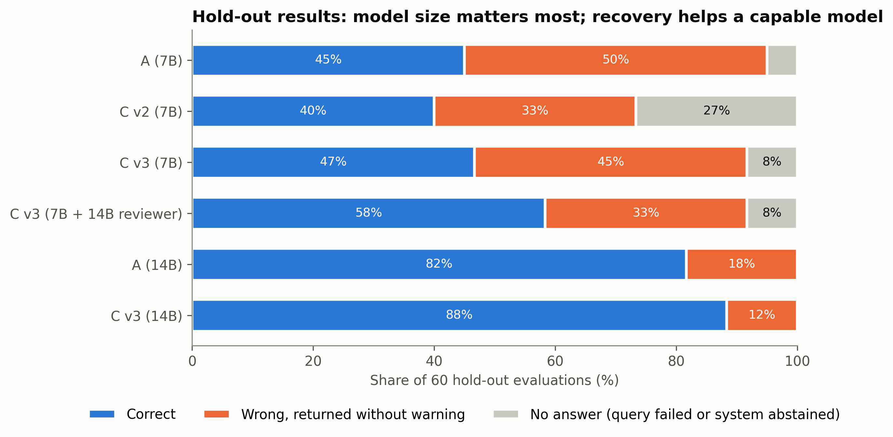

# Reliability-Aware Multi-Agent LLM System

**Design and Evaluation of a Reliability-Aware Multi-Agent LLM System with Autonomous Error Detection and Recovery for Natural Language Data Analysis**

Master's thesis project. The system answers natural-language questions about a SQLite database by generating SQL with a local LLM. It compares a single-agent baseline with multi-agent pipelines that detect and recover from their own errors.

## Key findings

On 20 hold-out questions (3 repetitions each) over the UCI Online Retail dataset:

| Configuration | Correct | Wrong, returned without warning | Avg latency |
|---|---:|---:|---:|
| A — single agent, qwen2.5:7b | 45.0% | 50.0% | 2.7 s |
| C v2 — keyword validator + recovery, 7b | 40.0% | 33.3% | 9.7 s |
| C v3 — self-consistency + result checks + recovery, 7b | 46.7% | 45.0% | 14.4 s |
| C v3 — 7b generator, 14b reviewer | 58.3% | 33.3% | 30.7 s |
| A — single agent, qwen2.5:14b | 81.7% | 18.3% | 8.0 s |
| **C v3 — all steps qwen2.5:14b** | **88.3%** | **11.7%** | 27.5 s |

1. **Domain definitions and model capability matter far more than agent architecture.** Adding business definitions to the schema prompt raised 7B accuracy from 36.7% to 67.8% on the development set. Moving from 7B to 14B raised hold-out accuracy from 45.0% to 81.7% (10 questions improved, 0 worse; sign test p = 0.002). The two effects were measured on different question sets and are not ranked against each other.
2. **No architectural change came close to either effect.** The best recovery design added at most 13.3 points.
3. **Self-recovery with a weak model does not work.** The 7B model's errors are systematic, so the generator, judge and repairer share the same blind spots.
4. **Recovery helps a capable model.** With 14B for every step, recovery fixed 4 answers and broke none (81.7% → 88.3%) at about 3.4× latency. This is consistent but not statistically significant on 20 questions.



More figures are in `results/figures/`. The full experimental record, including every decision, result file and limitation, is in [`docs/research_log.md`](docs/research_log.md).

## Systems

| System | Description | Code |
|---|---|---|
| A | Single LLM call: question + schema → SQL → execute | `experiments/run_experiment.py` (`run_system`) |
| B | SQL agent → executor → analysis agent (natural-language answer). Produces SQL identical to A. | `src/agents/orchestrator.py` |
| C v2 | B + execution-error detection + semantic validator (keyword rules + LLM check) + up to 2 repairs | `src/agents/orchestrator_c_v2.py`, `src/agents/semantic_validation_agent_v2.py` |
| C v3 | 3 SQL candidates with result voting, result-based checks, LLM judge that sees results, up to 3 repairs with retry-on-identical, optional separate reviewer model | `src/agents/orchestrator_c_v3.py` |

All SQL runs on a read-only SQLite connection with a timeout, a row limit, and a single-statement SELECT/WITH whitelist (`src/sql_executor.py`).

## Methodology

- **Data:** UCI Online Retail (541,909 rows) in SQLite. A synthetic NovaRetail database was used during early development.
- **Benchmarks:**
  - `experiments/online_retail_benchmark_v2.py`: 30 development questions.
  - `experiments/online_retail_benchmark_holdout.py`: 20 hold-out questions.
  - Every reference answer was verified with an independent second SQL formulation.
- **Contamination controls (Git tags):**
  - `validator-v2-freeze`: validator frozen before the new questions were written.
  - `holdout-frozen`: hold-out questions committed before System C v3 was designed.
  - `c3-frozen`: C v3 frozen before hold-out evaluation.
  - `experiments-complete`: all experiments finished.
- **Scoring:** one shared scorer for all systems (`src/scoring.py`). Numbers are compared with a tolerance of 0.01. Strict (exact columns) and lenient (extra columns allowed) verdicts are both recorded.
- **Runs:** temperature 0.3, seeds 42/43/44, 3 repetitions per question. LLM calls, tokens, latency and recovery attempts are recorded per evaluation.
- **Statistics:** McNemar exact test per evaluation, and a sign test per question. Repetitions are highly correlated, so per-question tests are the conservative reference.

## Reproducing the results

Requirements: macOS/Linux, Python 3.12, [Ollama](https://ollama.com).

```bash
conda create -n reliability-agents python=3.12 -y
conda activate reliability-agents
pip install -r requirements.txt

ollama pull qwen2.5:7b
ollama pull qwen2.5:14b
```

Download the UCI Online Retail dataset (`Online Retail.xlsx`) into `data/`, then build the database:

```bash
python experiments/create_online_retail_db.py
```

Run the tests:

```bash
python -m pytest tests/test_scoring.py tests/test_orchestrator_c_v3.py
```

Run an experiment (examples):

```bash
# Development set, business-definition schema, System A
python experiments/run_experiment.py --system A --reps 3 --temperature 0.3 --schema definitions

# Hold-out set, System C v3 with 14B for every step
python experiments/run_experiment.py --system C3 --reps 3 --temperature 0.3 --schema definitions \
    --benchmark holdout --gen-model qwen2.5:14b

# Pipeline test without an LLM (feeds the reference SQL)
python experiments/run_experiment.py --system C3 --schema definitions --mock
```

Options: `--system A|B|C|C3`, `--benchmark v2|holdout`, `--schema base|definitions`, `--gen-model`, `--review-model`, `--ids`.

Regenerate the figures from the result files:

```bash
python experiments/make_figures.py
```

## Project structure

```text
data/            SQLite databases and source data (not committed)
docs/            research_log.md (full experimental record), database_design.md
experiments/     benchmarks, unified runner, figure script, earlier experiment scripts
results/         experiment result JSON files, figures/
src/             LLM client, NL-to-SQL, SQL executor, scoring, agents/
tests/           unit tests (scoring, C v3 recovery, SQL security, evaluation)
```

Earlier scripts in `experiments/` (Days 1–38: fault injection, validator robustness and equivalence tests) are kept for traceability. They are described in the research log.

## Limitations

- One model family (Qwen 2.5, 7B and 14B), one database, 20 hold-out questions. Repetitions were highly correlated, so the effective sample size is close to the number of questions.
- The SQL safeguards are not a complete sandbox.
- Benchmark questions and parts of the code were produced with AI assistance. Reference answers were verified independently, and the chronology is recorded by Git tags.
